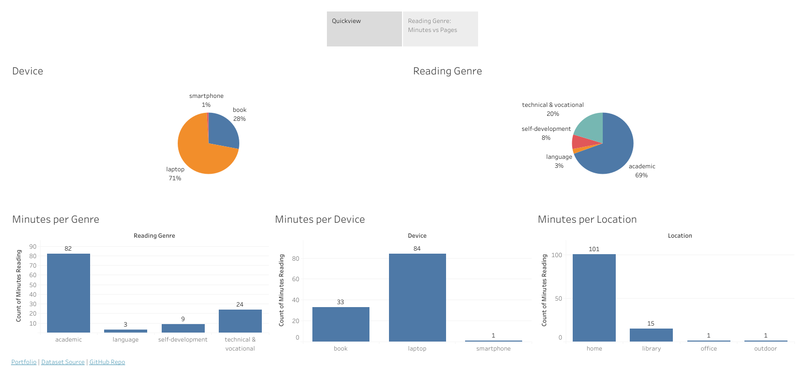

# Reading Performance Dashboard
Built in Tableau this dashboard features reading performance data. The dashboard showcases different metrics such as minutes read per genre/device/location so educators can better understand what, how, and where their students are reading.

## Exploratory Data Analysis

## Dashboard Preview 
[Reading Performance Dashboard](https://public.tableau.com/app/profile/anthony.nanfito/viz/reading-db/Story)

## Data Source
[Reading Performance (Kaggle)](https://www.kaggle.com/datasets/chibangng/reading-performance)

## Contact
- <a href="mailto:msg.for.anthony.p6ht3@simplelogin.com?subject=Nice Portfolio Project&body=Hey Anthony, I saw your portfolio project. Let's talk!">Email</a>
- [LinkedIn](https://www.linkedin.com/in/anthonynanfito/)
- [GitHub](https://www.github.com/ananfito)
- [Portfolio](https://ananfito.github.io)